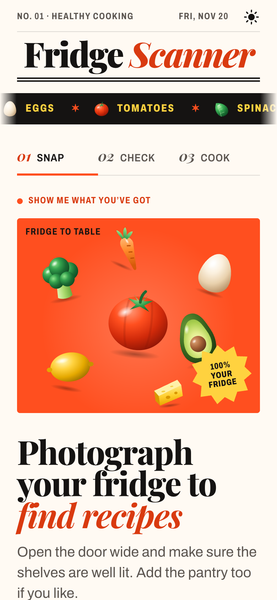
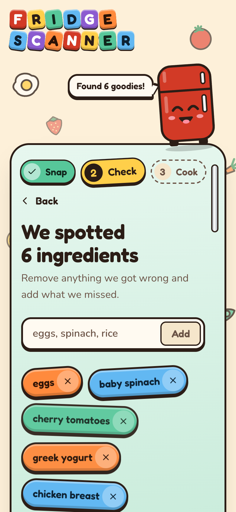
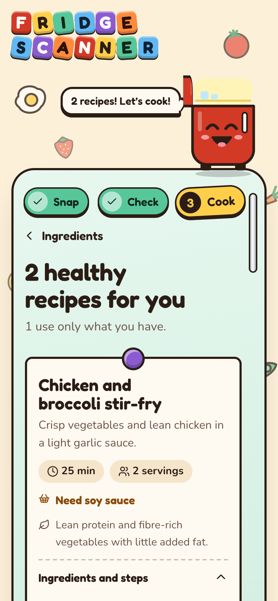

# Fridge Scanner

Snap a photo of your fridge or pantry and get healthy recipes, with steps, from the ingredients you already have.

**Live demo:** <https://prestoj01.github.io/Fridge-Scanner/>

<p>
  
  
  
</p>

## How it works

1. **Photos.** Add up to four photos, or drop or paste them on desktop. They are downscaled in the browser before upload.
2. **Ingredients.** A vision model lists the food it can see. You confirm, add, or remove items, then set preferences: diet, how long you have, foods to leave out, cuisine, and servings.
3. **Recipes.** The model suggests healthy recipes that use what you have, shows what you would still need to buy, and gives step-by-step instructions.

## Features

- **Saved recipes.** Heart any recipe to keep it on the Saved page.
- **Kitchen staples.** Tick what you always have (oil, salt, garlic, and so on). Recipes count them as on hand and never list them as missing.
- **Remembers your fridge.** Your ingredient list and preferences come back on your next visit.
- **Something different.** Swap any recipe for a new one, or ask for more ideas.
- **Ingredient swaps.** Missing something? Each recipe suggests what to use instead.
- **Shopping list.** Add a recipe's missing ingredients in one tap, check them off, and copy or share the list.
- **Nutrition.** Estimated calories, protein, carbs, and fat per serving.
- **Cooking mode.** A full-screen, high-contrast view with one step at a time, an ingredient checklist, step timers with a chime, and the screen kept awake.
- **Installable.** Add it to your home screen. After the first visit the app opens and works without a connection (typed ingredients and the built-in recipe library).
- **Sharing.** Share a recipe as a link (the whole recipe travels in the URL, no server needed) or as a magazine-style image.

Everything you save stays in your browser.

**Accessibility.** Every screen passes [axe](https://github.com/dequelabs/axe-core) checks in light and dark mode, including color contrast. Focus moves to the new heading on each step so screen readers announce it, cooking mode traps the page behind it, and all motion respects the reduced-motion setting. An axe test runs in CI.

The app also works with no backend at all. In **offline mode** you type your ingredients and recipes come from a built-in library, matched against what you have. If the AI service fails, hits its quota, or you are offline, the app switches to the same library on its own and says why, with a button to try the AI again.

## Design

The app is laid out like a food magazine: a masthead with an issue line, big black-weight Playfair Display headlines with italic emphasis, condensed Archivo kickers, hard rules, and bold spot colors (tomato, sunshine, cobalt, basil) on crisp paper or ink. A sun/moon toggle switches between light and dark with a circular reveal and otherwise follows the device.

The illustrations are glossy, 3D-style foods drawn in SVG (17 of them, from tomatoes to salmon), matched to each ingredient by name. They float on the cover with pointer parallax, sit beside every ingredient in the list, illustrate each recipe spread, and tumble into a mixing bowl while recipes cook.

Motion: an ingredient ticker scrolls under the masthead, a color panel wipes across between steps like a section opener, headlines reveal word by word, and recipe spreads open as you scroll. With reduced motion turned on, everything appears in place without movement.

## Architecture

```
Browser (GitHub Pages)                 Cloudflare Worker                Gemini API
React + TypeScript        POST /detect   validates input,     fetch      vision +
resizes photos       ──────────────────▶ rate limits,     ──────────────▶ JSON output
renders recipes      ◀────────────────── holds the API key ◀──────────────
                          POST /recipes
```

- The API key lives only in the Worker. It never reaches the browser.
- The Worker allows only listed origins, caps request sizes, can require a [Turnstile](https://developers.cloudflare.com/turnstile/) bot check, rate limits each client and the app as a whole (with Cloudflare's free Rate Limiting bindings), and validates everything the model returns before passing it on.
- Recipe replies are cached for a day in Cloudflare's edge cache, and for the session in the browser, so asking again with the same pantry and preferences costs no model quota.
- Request and response types are shared between the app and the Worker ([src/types/api.ts](src/types/api.ts)).

Everything runs on free tiers: GitHub Pages, Cloudflare Workers, and the Gemini API.

## Tech stack

- [Vite](https://vite.dev/) + [React](https://react.dev/) + [TypeScript](https://www.typescriptlang.org/) (strict), plain CSS, React state only
- [Motion](https://motion.dev/) for springs, morphing, layout and scroll animations; [Lucide](https://lucide.dev/) icons; Playfair Display and Archivo fonts, self-hosted
- [Cloudflare Workers](https://developers.cloudflare.com/workers/) for the API, with no runtime dependencies
- [Gemini API](https://aistudio.google.com/) for image understanding and recipe generation
- [Vitest](https://vitest.dev/) + [Testing Library](https://testing-library.com/), ESLint, Prettier
- GitHub Actions for CI and deployment to GitHub Pages

## Local setup

Requires Node.js 22 or newer.

```bash
npm install
npm run dev
```

Open <http://localhost:5173/fridge-scanner/>. With no further setup the app runs in offline mode.

### Turning on AI features locally

1. Create a free API key at <https://aistudio.google.com/apikey>.
2. Give it to the local Worker:

   ```bash
   cp worker/.dev.vars.example worker/.dev.vars
   # then edit worker/.dev.vars and set GEMINI_API_KEY=your-key
   ```

3. Point the app at the local Worker:

   ```bash
   cp .env.example .env
   # then edit .env and set VITE_API_URL=http://localhost:8787
   ```

4. Run both, in two terminals:

   ```bash
   npm run worker:dev
   npm run dev
   ```

## Deployment

### 1. The API (Cloudflare Worker)

Needs a free [Cloudflare account](https://dash.cloudflare.com/sign-up).

```bash
npx wrangler login
npm run worker:deploy
npx wrangler secret put GEMINI_API_KEY --config worker/wrangler.toml
```

The deploy command prints the Worker URL, for example `https://fridge-scanner-api.<your-subdomain>.workers.dev`. Opening `<worker-url>/health` should show `"configured": true` once the secret is set.

If you fork this project, change `ALLOWED_ORIGINS` in [worker/wrangler.toml](worker/wrangler.toml) to your own GitHub Pages origin.

### 2. The site (GitHub Pages)

1. In the repository, go to **Settings → Pages** and set **Source** to **GitHub Actions**.
2. Go to **Settings → Secrets and variables → Actions → Variables** and add a repository variable named `VITE_API_URL` with the Worker URL. Skip this to deploy in offline mode.
3. Optional: add a `VITE_TURNSTILE_SITE_KEY` variable to turn on the bot check (see below).
4. Push to `main`. The workflow in [.github/workflows/deploy.yml](.github/workflows/deploy.yml) lints, tests, builds, and deploys.

### 3. Bot protection (optional)

[Cloudflare Turnstile](https://developers.cloudflare.com/turnstile/) is free and stops scripts from spending your Gemini quota. Most visitors never see a challenge.

1. In the Cloudflare dashboard, open **Turnstile → Add widget**. Add your GitHub Pages hostname (and `localhost` if you want to test locally) and choose **Invisible**.
2. Give the secret key to the Worker:

   ```bash
   npx wrangler secret put TURNSTILE_SECRET --config worker/wrangler.toml
   ```

3. Add the site key as a repository variable named `VITE_TURNSTILE_SITE_KEY`, then push to rebuild the site.

Set both or neither. With only the secret, every AI request is refused. `<worker-url>/health` shows `"botCheck": true` once the secret is set.

## Scripts

| Command                 | What it does                                |
| ----------------------- | ------------------------------------------- |
| `npm run dev`           | Start the web app                           |
| `npm run worker:dev`    | Start the API locally on port 8787          |
| `npm run build`         | Type-check and build the web app to `dist/` |
| `npm run preview`       | Serve the production build locally          |
| `npm test`              | Run all tests once                          |
| `npm run lint`          | Lint with ESLint                            |
| `npm run format`        | Format with Prettier                        |
| `npm run check`         | Lint, format check, test, and build         |
| `npm run worker:deploy` | Deploy the API to Cloudflare                |

## Project structure

```
src/
  components/   Shared UI: masthead, recipe cards, cooking mode, food illustrations
  screens/      One component per step (Upload, Review, Recipes) and page (Saved, List, Shared)
  hooks/        useScanFlow, which owns the flow state and async actions, plus timers and routing
  lib/          API client, image resizing, validation, recipe matching, sharing
  data/         Built-in recipe library
  types/        Shared types, including the API contract
pwa/            Service worker template; the build adds the file list
public/         Icons, manifest
worker/
  src/          Cloudflare Worker: routing, CORS, rate limits, cache, bot check, prompts, Gemini client
```

## Privacy

Photos are resized and re-encoded in your browser, which also strips metadata such as location. They are sent to the Worker and on to the Gemini API only when you press **Detect ingredients**. The Worker does not store photos or ingredient lists, and asks the Gemini API not to store the request. Google's own handling of free-tier API data is described in the [Gemini API terms](https://ai.google.dev/gemini-api/terms).

## Limitations

- Detection only finds food that is visible. Items in drawers or opaque containers are missed, so the review step matters.
- Recipes are AI-generated suggestions. Check for allergens and use your own judgment on food safety.
- The free Gemini tier has daily limits. When they are reached, the app falls back to the built-in library.

## License

[MIT](LICENSE)
